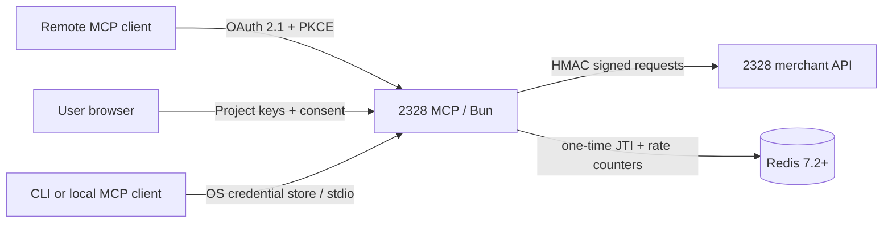

# Architecture

The server is a stateless security boundary between an MCP client and the existing 2328 merchant API.

## Runtime paths

- Remote: Streamable HTTP at `/mcp`, stateless JSON responses, OAuth protected-resource discovery.
- Local MCP: `2328 --mcp` over stdio, with credentials resolved from the environment or an OS-backed profile.
- Interactive CLI: `2328` exposes payments, payouts, static wallets, conversions and market/account views without involving an LLM.
- 2328 API: exact-body HMAC SHA-256 using the ordinary project key or the separate payout key.

Remote access and local access use the same tool registry and validation rules. No application database is required. Redis stores only expiring replay identifiers and rate-limit counters; it never stores 2328 credentials.

## Authorization

The bundled authorization server implements Authorization Code with PKCE S256 and dynamic client registration for public MCP clients. Authorization codes, access tokens, payout preparations and conversion preparations are compact JWE values encrypted with A256GCM. They bind issuer, audience, subject, scope, expiry and a unique identifier.

The connection screen asks for project credentials, not the 2328 account password. The ordinary API key is verified with `GET /balance`. A payout key is required when any payout scope is requested. The access token lifetime is 15 minutes by default and there is no refresh token: the user must reconnect after expiry.

This design matches the current 2328 HMAC API. A future first-party 2328 authorization service can replace the bundled authorization routes without changing MCP tools: issue delegated tokens from the 2328 account UI and resolve them to a project-scoped upstream credential.

## Money movement

Payouts are deliberately split:

1. `payout_prepare` validates fields and requests a live fee quote without moving funds.
2. The client displays the exact amount, debit, fee, network and destination.
3. `payout_create` accepts only the encrypted preparation and its exact confirmation phrase.

The preparation expires after five minutes and is bound to the connection. Its `order_id` makes upstream retries idempotent. Clients must still treat the MCP destructive annotation as a mandatory human-confirmation gate.

Auto-convert payouts using `from_currency` are deliberately not exposed by the MCP yet. The current upstream payout calculator rejects that mode, so the server cannot show an authoritative debit/fee quote before confirmation. Direct payout API support remains an upstream capability, not a safe agent capability, until a matching read-only quote exists.

Balance conversions use the same prepare/confirm pattern with a shorter default preparation lifetime. The quote is indicative and does not reserve a price. `convert_execute` is never automatically retried after a timeout because execution may have succeeded even when its HTTP response was lost.

## Local profiles

Profile metadata contains a name, project ID, API origin and whether a payout key exists. API key values are stored through `Bun.secrets` in Windows Credential Manager, macOS Keychain or Linux Secret Service. Environment variables take precedence for automation and headless deployments. Local preparation encryption uses a fresh process-ephemeral key when no hosted encryption key is configured.

## Scaling

The MCP transport and OAuth tokens are stateless. Instances can scale horizontally behind a TLS reverse proxy when they share `TOKEN_ENCRYPTION_KEY` and Redis. Rotate the encryption key by draining old instances; an immediate replacement intentionally revokes every outstanding MCP token.
